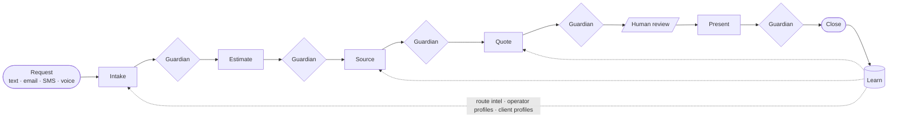

# Dumont Agent

[](https://github.com/PhelipeHonesto/dumont-agent/actions/workflows/ci.yml)


> Named after Alberto Santos-Dumont, the Brazilian who flew first. Now an AI that brokers flights.

**Dumont** is the charter-brokerage orchestrator behind [OSA Connect](https://orangesunshineaviation.com). A client request comes in as free text, email, SMS, or voice. Dumont qualifies the client, prices the trip, picks **one** operator, and presents one quote. A validation gate checks the deal after every stage, the way a ground-proximity warning system watches a flight. Every closed deal feeds back into pricing, operator, and client memory.

The industry default is to blast RFQs to twenty operators and forward the cheapest reply. Dumont does the opposite: **one quote, one operator, one deal**, checked against runway length, range, passenger capacity, certificates, and budget before anyone sees a price.

---

## How a deal flows



One orchestrator (`src/orchestrator/`, the "pilot in command") decides what runs next. The five capabilities are functions it calls, not independent agents passing a baton.

| Capability | What it does |
| --- | --- |
| **Intake** | Parses free text into a structured trip, resolves city names to ICAO airports, qualifies the client, detects repeat clients |
| **Guardian** | Five stage-specific validation passes. Critical failures block the deal; soft flags warn. Checks runway length (+10% margin), great-circle range, passenger capacity, trip date, budget overlap, operator certificate, and quote sanity |
| **Quote** | Physics-first validation, then Aviapages pricing corrected by historical deltas from closed deals |
| **Sourcing** | Ranks operators on fit, reliability, price accuracy, availability, and **ghost positioning**: aircraft already parked near the departure airport, found from ADS-B data |
| **Scenario** | Presents one primary option plus one backup, with the client's substitution preferences and a validity timer |

## What makes it more than a prompt chain

- **Hard gates, not suggestions.** Guardian runs after every stage, and a critical check stops the pipeline. LLM output goes through Zod schemas at every boundary, so malformed model output fails loudly instead of flowing downstream.
- **Deterministic where it matters.** Runway, range, and capacity are computed from aircraft performance data and haversine distance, not asked of a model.
- **An append-only deal log.** `deal_events` is never updated or deleted. Every decision is replayable.
- **Money in integer cents.** No floating-point pricing anywhere.
- **A learning loop with a closed definition.** Every closed deal becomes a `DealRecord` that updates `route_intel`, `operator_profiles`, and `client_profiles`. Those tables feed the next estimate and ranking.
- **Spec-first.** Every capability has a written spec in [`specs/`](specs/) that came before the code and is the source of truth when they disagree.

## Evidence

| Check | Result | Reproduce |
| --- | --- | --- |
| Unit and integration tests | **681 passing** across 25 files | `npm test` |
| Type check | Clean (strict) | `npm run typecheck` |
| Layer isolation (agent code never imports data-platform code) | Passing | `npm run lint:layers` |
| End-to-end scenario suite | **22 / 25 pass (88%)** against a 72% target | `npm run sim` |
| CI | Type check, layer check, and tests on every push | [Actions](https://github.com/PhelipeHonesto/dumont-agent/actions) |

The scenario suite runs 25 realistic requests through the full pipeline with mocked pricing: "NY to South Florida next Friday, 3 people, $25k–35k", SMS shorthand, email signatures, pets and golf clubs, wheelchair access, international legs, budgets that can't work. The three that fail are known gaps: an ultra-long-range budget miss, wheelchair-accessible sourcing, and one SMS shorthand case.

## MCP server: 12 aviation intelligence tools

Dumont exposes its data layer to Claude and other MCP clients over stdio (local) or SSE (remote).

| Tool | Returns |
| --- | --- |
| `lookup_aircraft` | Full aircraft profile by tail number |
| `get_flights` | Flight history for an aircraft |
| `find_ghosts` | Ghost-fleet candidates: aircraft already positioned near an airport |
| `fleet_stats` | Fleet intelligence summary |
| `route_intel` | Route analytics between two airports |
| `operator_analysis` | Operator utilization, routes, and trend |
| `airport_report` | Hourly airport activity |
| `market_overview` | Monthly market intelligence |
| `active_listings` | Aircraft for sale |
| `recent_transactions` | FAA ownership changes |
| `data_health` / `feed_health` | Data freshness and ADS-B feed status |

Details: [`docs/mcp-tools.md`](docs/mcp-tools.md).

## Quickstart

Requires Node 22.

```bash
npm install
npm test            # 681 tests
npm run typecheck
npm run sim         # 25-scenario end-to-end run, no API keys needed
npm run sim -- --scenario S02
npm run dashboard   # Mission Control UI (Vite + React)
npm run mcp:serve   # MCP server over stdio
```

Live operation (Postgres, Aviapages pricing, the Anthropic API, Vapi voice) is configured through environment variables. See [`.env.example`](.env.example) and [`docs/operations.md`](docs/operations.md).

## Repository map

```
src/orchestrator/   pilot-in-command, DealContext, stage transitions
src/capabilities/   intake · guardian · quote · sourcing · scenario
src/schemas/        Zod schemas, the runtime source of truth
src/memory/         Postgres / SQLite bridge, deal store, learning loop
src/mcp/            MCP server (stdio + SSE), 12 tools
src/server/         HTTP API: voice webhook, dashboard, intelligence routes
specs/              SPARC specs for the orchestrator, each capability, and the learning loop
scenarios/          25 end-to-end validation scenarios
dashboard/          Mission Control (Vite + React)
tests/              Vitest suite
```

## Part of the OSA stack

| Repo | Role |
| --- | --- |
| **dumont-agent** (this repo) | Agent: reasons over the data and runs the deal |
| [osa-data-platform](https://github.com/PhelipeHonesto/osa-data-platform) | Ingests ADS-B, FAA, and NTSB data and resolves it into canonical operators and aircraft |
| [ph-brain-engine](https://github.com/PhelipeHonesto/ph-brain-engine) | Long-term memory substrate served over MCP |
| [Aviation-News-Aggregator](https://github.com/PhelipeHonesto/Aviation-News-Aggregator) | Loud Hawk: aviation news and signals |

The two repos share a Postgres cluster and talk over SQL. There's no HTTP between them.

## License

Proprietary. Orange Sunshine Aviation, LLC. The source is public for review; no license to use it is granted.
